# Hemodinâmica — protótipo de sistema hospitalar

Protótipo web responsivo do sistema **Hemodinâmica**. Ele acompanha cada procedimento do pedido médico ao faturamento e reúne agenda, perfis com login e estoque com rastreabilidade por produto, lote, validade e localização. Todos os dados são fictícios e ficam só no navegador.

A Hemodinâmica não tem relação com a Jusimed. O módulo de estoque nasceu de um conceito independente e não oficial feito para a Jusimed, e os documentos sobre esse conceito continuam em `docs/` como histórico.

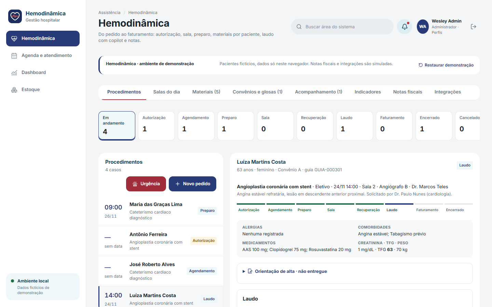

## Telas

Prints do protótipo rodando com os dados de demonstração.

### Entrada

No primeiro acesso, o sistema pede para criar o administrador. Depois disso, cada pessoa entra com login ou e-mail e senha e vê só o que o seu perfil permite (administrador, médico ou equipe).

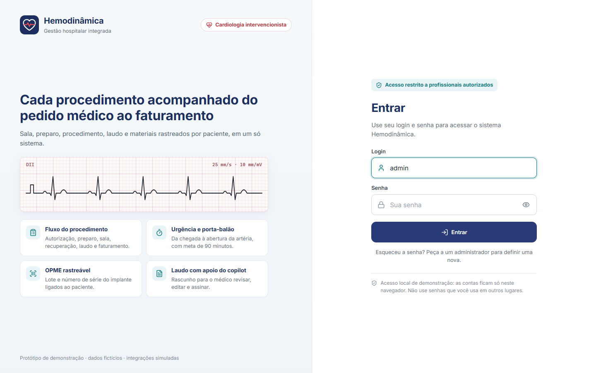

### Hemodinâmica

**Urgência e porta-balão.** A urgência abre direto na sala, já com o médico de sobreaviso do dia. O quadro por etapas mostra onde o tempo se perdeu, da chegada do paciente até a abertura da artéria.

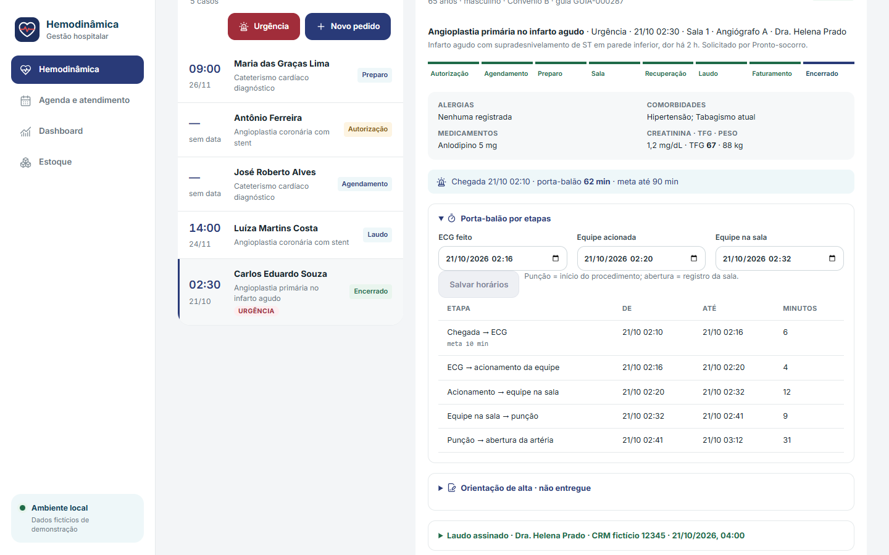

**Na sala.** A equipe registra os medicamentos com dose, via e horário (o sistema não sugere doses). O TCA é registrado com o alvo definido pelo médico, e a ficha avisa quando a medida fica abaixo dele. As imagens da angiografia são vinculadas pelo número de acesso.

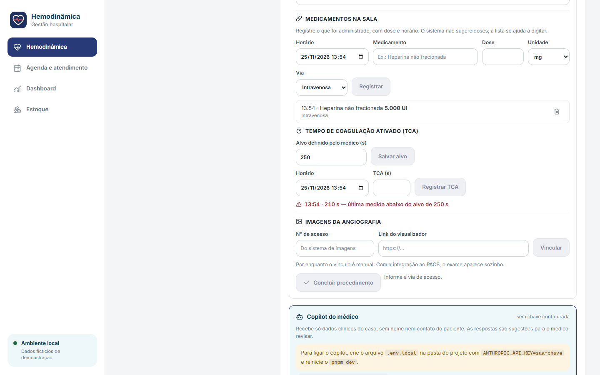

**Materiais.** Esta aba reúne:

- o rastreio de lote ou número de série, para recall;
- o pedido de reposição sugerido por fornecedor;
- os alertas de validade e de saldo mínimo;
- a reposição de consignados usados em pacientes.

Os materiais são os mesmos produtos do Estoque.

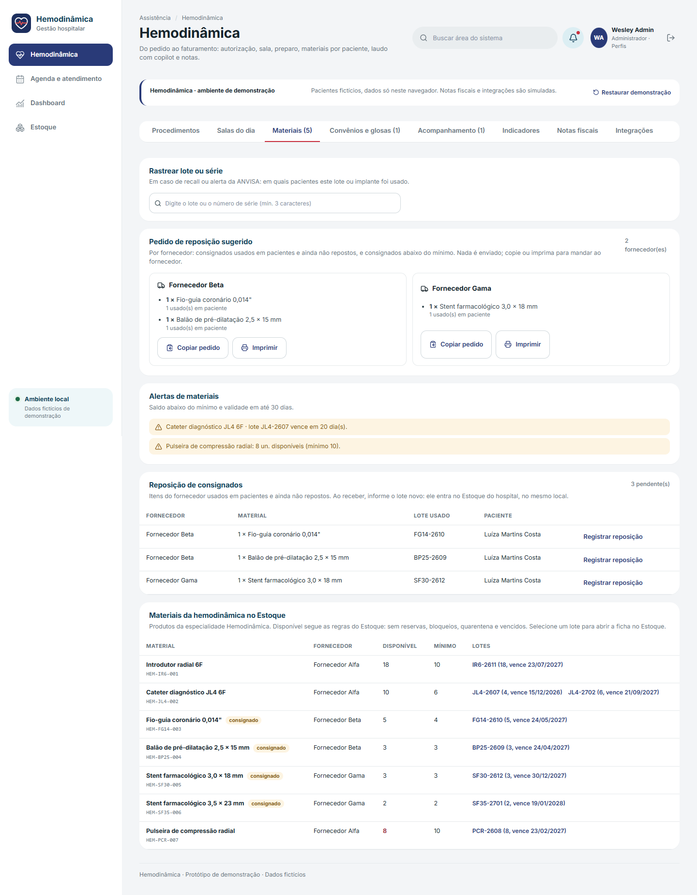

**Indicadores.** São calculados só com o que foi registrado, sem estimativas: porta-balão e suas etapas, acesso radial, contraste, radiação por hemodinamicista, eventos em 30 dias, glosas, creatinina de controle, termos assinados e orientações de alta entregues.

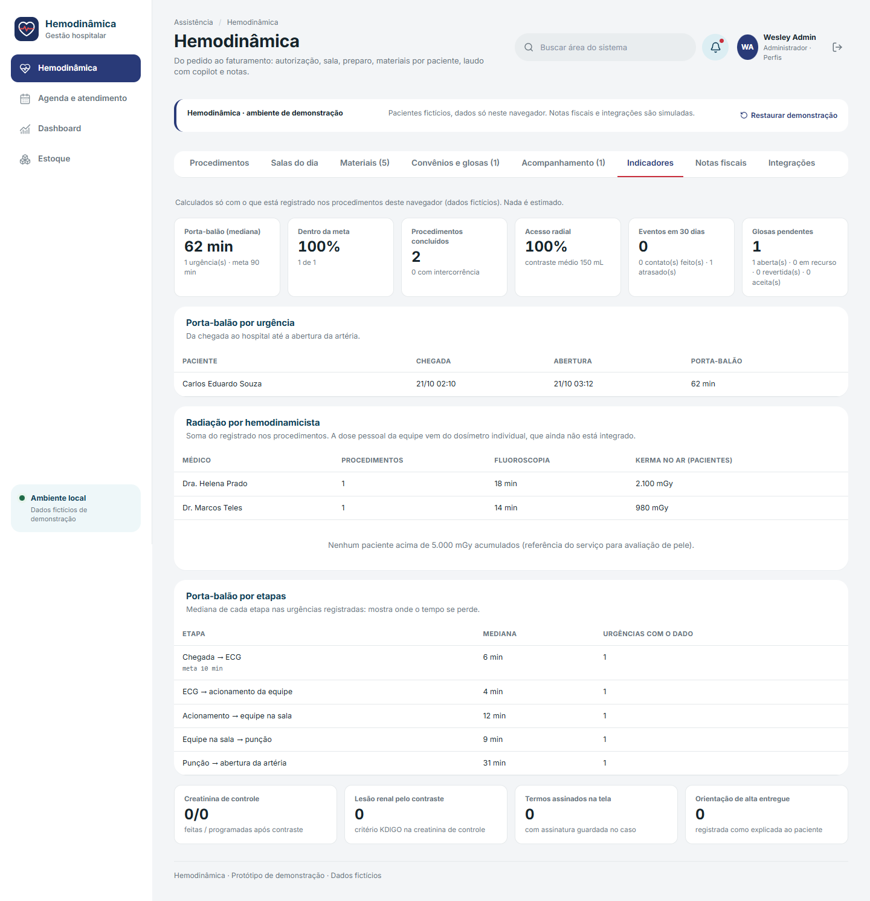

### Agenda e atendimento

A agenda mostra a semana de consultas. Um horário só é oferecido se o profissional, o paciente e a sala estiverem livres.

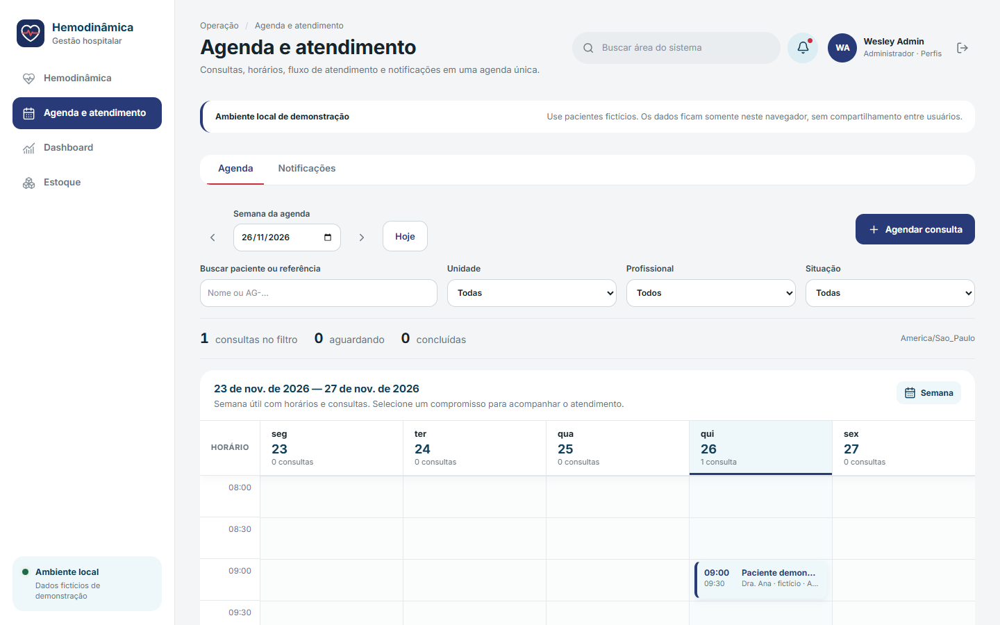

### Perfis

Qualquer usuário cadastra pacientes. Só o administrador cadastra médicos e profissionais e gerencia quem tem acesso.

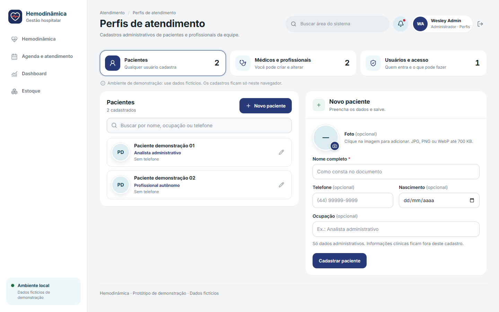

### Estoque

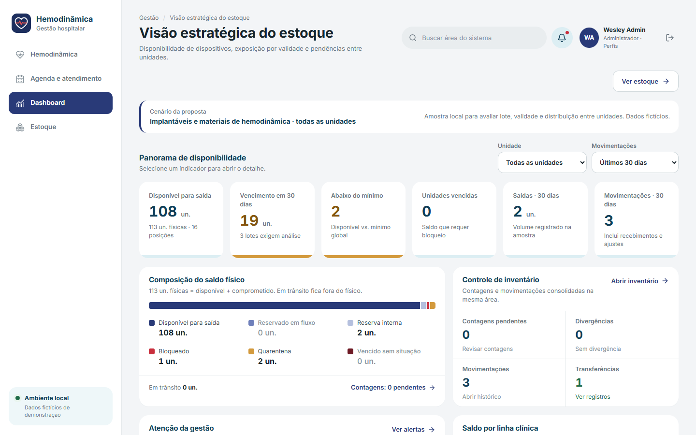

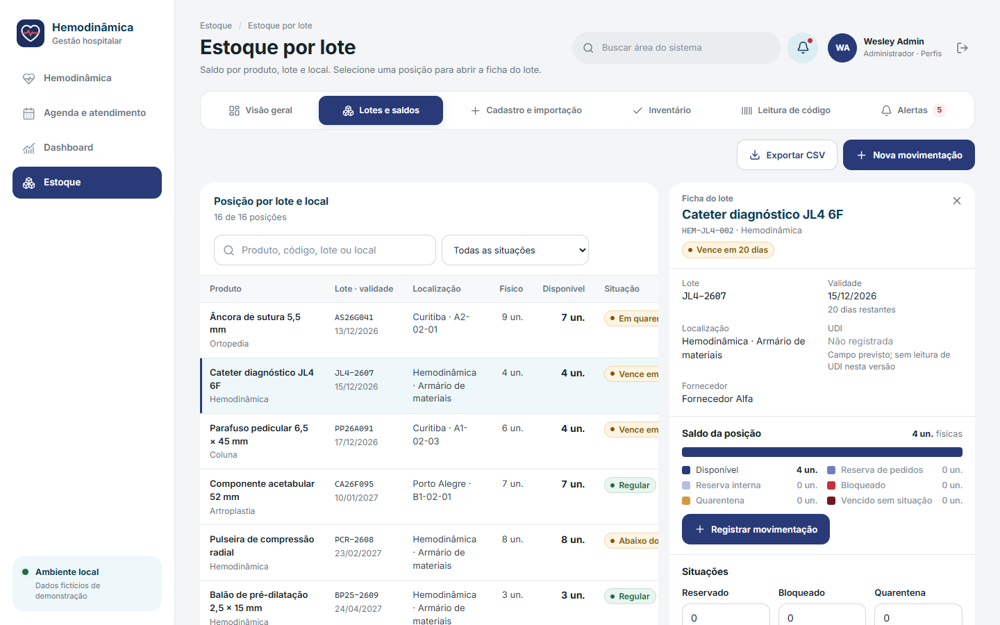

### No celular

<p>
  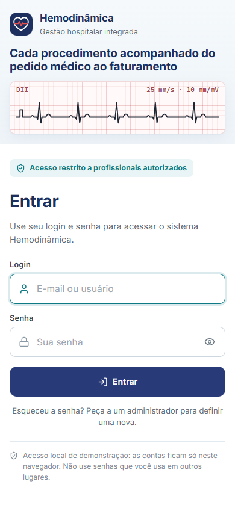
  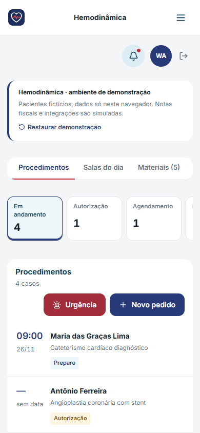
</p>

## Executar localmente

Requisitos: Node.js 24 e pnpm. Os testes usam a execução nativa de TypeScript do Node.

```powershell
pnpm install
pnpm dev
```

Abra o endereço exibido no terminal e crie o administrador. Não existe senha padrão.

O copilot do médico é opcional. Para ligá-lo, copie `.env.example` para `.env.local`, preencha `ANTHROPIC_API_KEY` e reinicie o `pnpm dev`. Sem a chave, o resto do sistema funciona normalmente.

Para testar a leitura pela câmera em um celular, sirva o protótipo por HTTPS. Em `localhost`, o navegador também pode autorizar a câmera. A leitura manual funciona sem câmera.

## O que funciona nesta versão

### Acesso

- Login com perfis de administrador, médico e equipe. As senhas são guardadas com PBKDF2.
- Cada entrada do histórico mostra o usuário que fez a ação. Detalhes em [acesso e permissões](docs/acesso-e-permissoes.md).

### Hemodinâmica

- **Fluxo do procedimento:**
  - autorização, com pedido de OPME;
  - agendamento sem conflito de sala, médico ou paciente;
  - preparo com time-out e consentimento assinado na tela;
  - sala e recuperação;
  - laudo assinado pelo hemodinamicista;
  - faturamento com notas simuladas.
- **Urgência:** porta-balão por etapas e escala de sobreaviso.
- **Segurança clínica:**
  - TFG estimada (CKD-EPI 2021) e limite sugerido de contraste;
  - creatinina de controle e critério KDIGO para lesão renal;
  - alertas de alergia a contraste, anticoagulante, metformina e dose de radiação;
  - cronômetro da pulseira radial;
  - orientação de alta.
- **Rastreabilidade e convênio:** implantes com número de série, rastreio de lote ou série, prévia da guia TISS e glosas com recurso.
- **Depois do procedimento:** acompanhamento de 30 dias e indicadores.
- **Copilot do médico (IA):** recebe o caso sem o nome e sem o contato do paciente.

Detalhes em [docs/hemodinamica.md](docs/hemodinamica.md).

### Agenda e perfis

- Agenda semanal com tipos de consulta, encaixes e notificações internas.
- Cadastro de pacientes (dados administrativos, sem prontuário) e de profissionais, com unidades, salas e grade de atendimento.

Detalhes em [agenda e configurações hospitalares](docs/agenda-hospital-local.md).

### Estoque

- **Dashboard:**
  - contexto da base e seis indicadores clicáveis;
  - composição do saldo físico: disponível, reservas, bloqueio, quarentena e vencido;
  - atenção da gestão, tendência de movimentações e cobertura dos registros.
- **Consulta de saldo:** por produto, lote e localização, com busca e filtro por situação.
- **Ficha do lote** (`#/estoque/<id>`): painel ao lado da lista, ou em tela cheia abaixo de 1280 px. Mostra validade, local, composição do saldo, situações, movimentações, contagens e alterações da posição.
- **Leitura de código:** consulta por código do produto ou lote. O código pode ser digitado, lido pela câmera ou lido por bipador USB/Bluetooth em modo teclado.
- **Cadastro:** produtos, fabricante, fornecedor, mínimo e posições por lote, local e validade. Os produtos podem ser marcados como implantáveis ou consignados.
- **Importação de Excel (.xlsx) e CSV:** com prévia, validação de todas as linhas e bloqueio de duplicidades. O modelo de planilha está disponível na interface.
- **Movimentações:**
  - entrada, saída e transferência;
  - a transferência fica em trânsito até a confirmação no destino;
  - a saída é bloqueada acima do disponível ou em lote vencido.
- **Inventário físico:** a contagem é feita sem mostrar o saldo esperado. Divergências exigem justificativa, e há uma revisão simulada antes do ajuste.
- **Alertas e exportação:** alertas ilustrativos de validade e saldo mínimo e exportação CSV da posição de estoque.

## Limites

Esta é uma demonstração local:

- **Login:** o login funciona só neste navegador. Não há autenticação em servidor.
- **Servidor:** não há servidor nem banco de dados compartilhado. A única exceção é a rota local do copilot.
- **Edições simultâneas:** a base não coordena edições entre abas ou dispositivos, e o próprio navegador pode apagar os dados.
- **Integrações:** eGestor, SPDATA e Apollo aparecem como não conectadas.
- **Notas fiscais:** são simuladas.
- **Fora desta versão:** controle de múltiplas empresas, validação regulatória e auditoria imutável.
- **Bipador:** deve operar como teclado.
- **Revisão de inventário:** é feita pelo mesmo usuário.

Não insira dados reais ou pessoais.

## Verificação

```powershell
pnpm test
pnpm build
```

Os testes cobrem as regras de estoque, agenda, hemodinâmica, segurança clínica e acesso. `tests/fixtures/estoque-exemplo.xlsx` é um arquivo sintético usado para conferir o leitor de Excel. A câmera e os bipadores físicos ainda precisam ser validados com os equipamentos reais.

## Documentação

- [Hemodinâmica: fluxo, segurança clínica, copilot e integrações](docs/hemodinamica.md)
- [Acesso e permissões](docs/acesso-e-permissoes.md)
- [Agenda e configurações hospitalares](docs/agenda-hospital-local.md)
- [Definições dos indicadores do Dashboard](docs/analytics.md)
- [Escopo funcional e regras do estoque](docs/escopo-funcional.md)
- [Guia dos módulos de estoque e formato de importação](docs/operacao-v2.md)
- [Arquitetura e evolução para SaaS](docs/arquitetura-evolucao.md)
- [Direção visual](docs/direcao-visual.md)

Histórico do conceito de estoque, mantido como registro:

- [proposta](docs/proposta-apresentacao.md)
- [validação com cliente](docs/validacao-com-cliente.md)
- [pedidos e expedição](docs/pedidos-expedicao.md) (módulo retirado desta demonstração)
- [identidade Jusimed](docs/identidade-jusimed.md)
- [referência Patrimônio Ops](docs/referencia-patrimonio-ops.md)

## Estrutura

- `src/App.tsx`: entrada, navegação e integração das áreas.
- `src/auth/`: perfis de acesso, senhas e as telas de entrada e de usuários.
- `src/hemo/`: hemodinâmica.
  - `domain.ts`: regras do fluxo e parte renal.
  - `clinical.ts`: segurança clínica.
  - `HemoWorkspace.tsx` e `ClinicalPanels.tsx`: telas.
- `src/hospital/`: agenda, perfis e configurações.
- `server/copilot.ts`: rota `/api/copilot`, servida pelo Vite, que chama a API da Anthropic.
- **Estoque:**
  - `src/data.ts`: dados fictícios e migração;
  - `src/domain.ts`: regras;
  - `src/importing.ts`: leitura de CSV e Excel;
  - `src/Catalog.tsx`, `src/StockControls.tsx` e `src/Inventory.tsx`: telas dos módulos;
  - `src/LotSheet.tsx` com `src/lotTrace.ts`: ficha do lote;
  - `src/Analytics.tsx`: Dashboard.
- **Estilos:** tokens em `src/styles.css`, mais um arquivo `.css` por área.
- `tests/`: testes com o executor nativo do Node.
- `docs/prints/`: imagens deste README.
