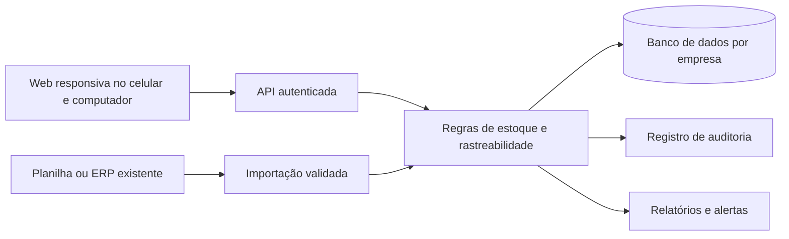

# Arquitetura e evolução para SaaS

## Estado atual

Aplicação React + TypeScript + Vite executada no navegador. Dados fictícios residem no `localStorage` de cada dispositivo. A leitura usa a câmera do navegador quando há permissão e contexto seguro. **Dois usuários não compartilham o mesmo estoque nesta versão.**

## Arquitetura proposta para produção

A aplicação continuaria web se esse for o formato aprovado. SaaS significa prestação contínua do serviço, com contas e dados separados por empresa, suporte, atualizações e cobrança contratual; não exige um aplicativo instalado.

## Ordem recomendada

1. Validar etiquetas, planilha, processos e indicadores com a empresa.
2. Fazer um piloto em uma unidade ou conjunto limitado de produtos, mantendo reconciliação com a fonte oficial.
3. Implementar servidor, autenticação, permissões, auditoria e backups; transportar as regras e a importação local já demonstradas para transações no servidor.
4. Só então generalizar configurações para outras empresas e estruturar operação SaaS.

## Riscos de produto

- Uma câmera pode ler o código, mas o código talvez não contenha todos os campos necessários.
- Saldo exibido sem reconciliação com a fonte oficial pode gerar decisões erradas.
- Operação offline com múltiplos usuários exige regras explícitas de sincronização e conflito.
- Requisitos de qualidade e rastreabilidade devem ser validados com a área responsável antes de uso real.
- Cobrança e isolamento entre clientes precisam ser projetados antes de aceitar dados de múltiplas empresas.
